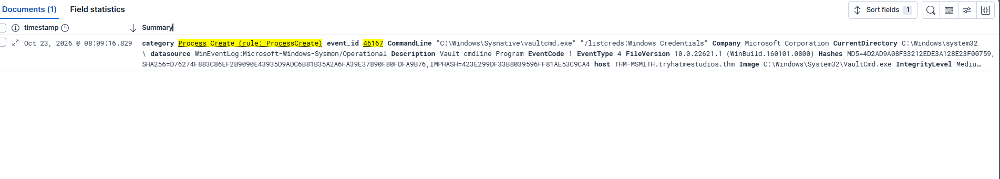

# Anomalous Credential Vault Access




***This is a writeup for a SOC simulation scenario from the TryHackMe "It's Downtime! 2026" event.***

## Time of activity: 

8:09:16:829

## List of Affected Entities:

host: THM-MSMITH.tryhatmestudios.thm  
User: "TRYHATME\\m.smith"

## Reason for Classifying as True Positive:

This activity is classified as a True Positive due to the detection of execution of VaultCmd.exe "/listcreds:Windows Credentials" from THM-MSMITH.tryhatmestudios.thm via commandline at 8:09:16:829. It was launched by the execution of a hidden ParentcommandLine process running svchost_update.ps1, via powershell.

## Reason for Escalating the Alert:

Execution of VaultCmd.exe via parentcommandline script in hidden mode which may have lead to Credentials access of the user TRYHATME\\m.smith, hence further escalation required to investigate the process.

## Recommended Remediation Actions:

- Kill the parent process.
- Reset the credentials.
- Check for persistence and lateral movement.

## List of Attack Indicators:

- ParentCommandLine:```"C:\Windows\System32\WindowsPowerShell\v1.0\powershell.exe" -NoP -W Hidden -ExecutionPolicy Bypass -File "C:\Users\MC0CD~1.SMI\AppData\Local\Temp\svchost_update.ps1"```
- CommandLine:```"C:\Windows\Sysnative\vaultcmd.exe" "/listcreds:Windows Credentials"```