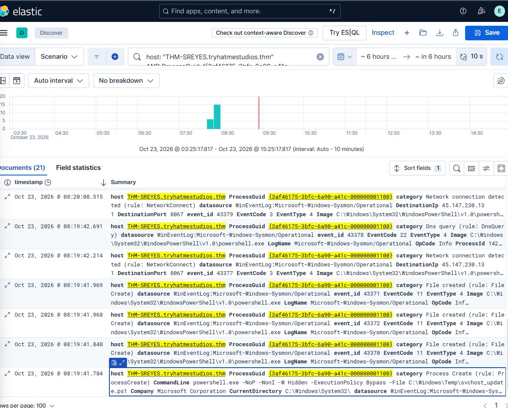

# Exfiltration

***This is a writeup for a SOC simulation scenario from the TryHackMe "It's Downtime! 2026" event.***

## Time of activity:
8:19:41.784 IST
## List of Affected Entities:

Host: THM-SREYES.tryhatmestudios.thm
User: NT AUTHORITY\\SYSTEM

## Reason for Classifying as True Positive:

This activity is classified as a True Positive due to suspicious outbound connection from the host THM-SREYES.tryhatmestudios.thm to destinationIp 45.147.230.131 made via powershell multiple times, after the successful execution of hidden powershell command at 8:19:41:784 IST followed by creation of multiple suspicious file. However, successful data transfer has not been independently confirmed.

## Reason for Escalating the Alert:

At 08:19:41.784 a process is created via a ParrentCommandLine \\\Windows\\Temp\\svchost_update.ps1" followed by file creations script "C:\\Windows\\Temp\\__PSScriptPolicyTest_3z14vipy.mip.ps1" at 08:19:41.848, "C:\\Windows\\Temp\\5ywlufsj\\5ywlufsj.cmdline" at 08:19:41.968, "C:\\Windows\\Temp\\5ywlufsj\\5ywlufsj.dll" at 08:19:41.969 and then consecutive network connection detected to 45.147.230.131 all these in a short span of time after the execution of ParentCommandLine script. Hence further escalation required to check for data exfiltration.

## Recommended Remediation Actions:

- Isolate the host.
- Kill the powershell process.
- Analyze the files.
- Check for persistence and lateral movement.
- Block the destination IP.

## List of Attack Indicators:

- DestinationIp: 45.147.230.131
- Files:
	- `C:\Windows\Temp\svchost_update.ps1`
	- `C:\Windows\Temp\_PSScriptPolicyTest_3z14vipy.mip.ps`
	- `C:\Windows\Temp\5ywlufsj\5ywlufsj.cmdline`
	- `C:\Windows\Temp\5ywlufsj\5ywlufsj.dll`
